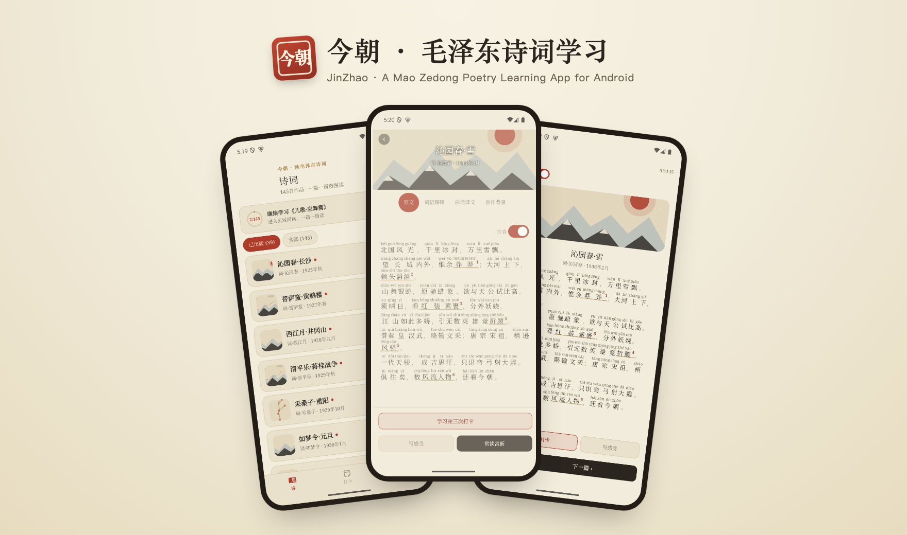
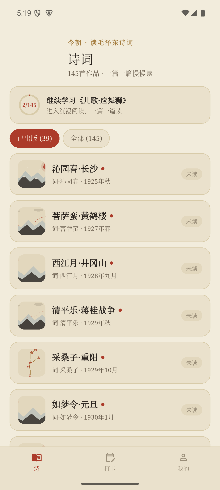
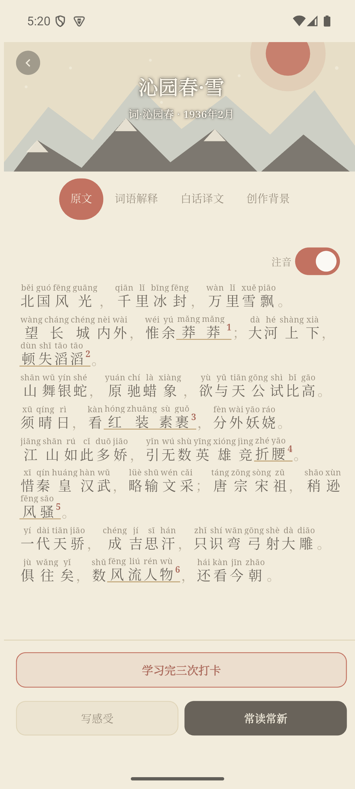
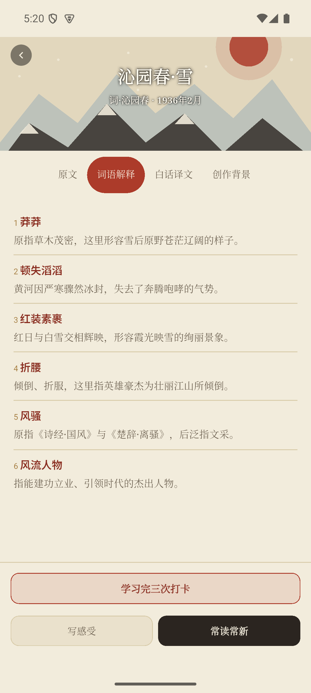
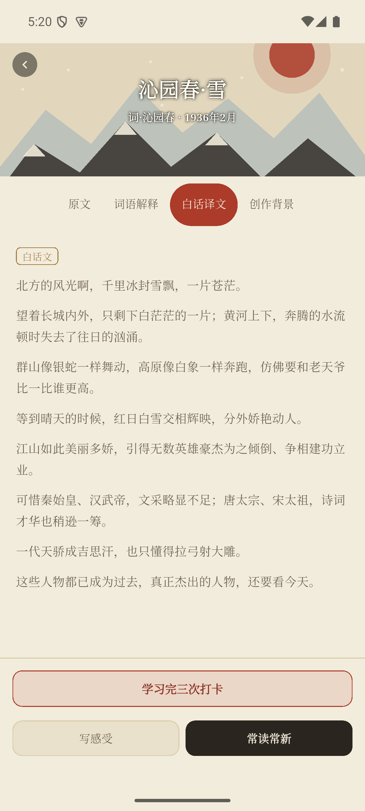
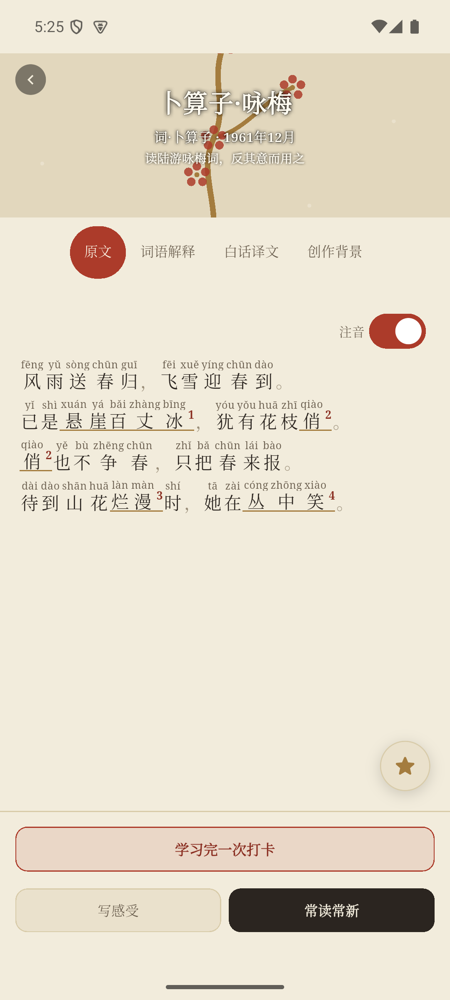
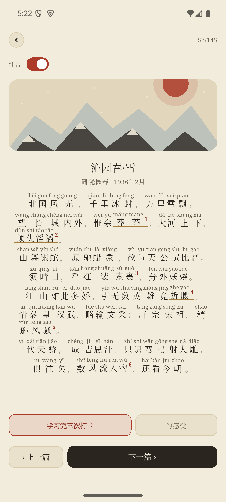
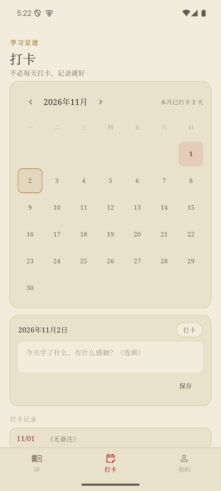
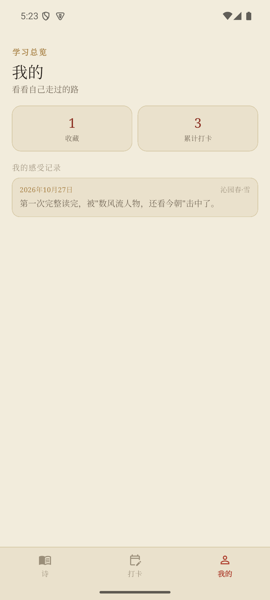
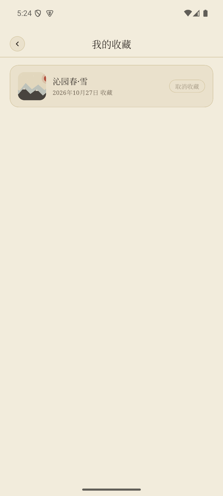

# 今朝 · JinZhao



**毛泽东写诗词这件事，贯穿了他的一生。** 从少年时"埋骨何须桑梓地，人生无处不青山"的立志，到长征路上"更喜岷山千里雪，三军过后尽开颜"的豪情，再到晚年的沉吟咏叹，几十年间他把治国、征战、人生起伏都写进了诗词里，格律深厚又气象宏大，是读中国近现代史很难绕开的一批文本。今朝就是为了认真读这些诗词做的一个原生 Flutter / Android 应用：126 首毛泽东诗词全收录——远不止教科书里常见的 39 首权威篇目，连早年习作、联句残篇、战争年代的即兴之作也一并收齐，逐首都配有逐字注音、词语解释、白话译文、创作背景，陪你一篇一篇慢慢读，也允许你一读再读。

[下载手机测试版 APK](https://github.com/Sam-byte1/jinzhao-android/releases/tag/v0.21.0) · [下载平板测试版 APK](https://github.com/Sam-byte1/jinzhao-android/releases/tag/tablet-v0.21.0) · [反馈问题](https://github.com/Sam-byte1/jinzhao-android/issues) · [MIT 许可证](LICENSE)

> **当前为早期测试版（V0.21.0）。** 安装包为本地 debug 签名，未上架 Google Play，也未经过任何应用商店审核。从 Release 页面下载后，Android 会提示"未知来源"或"此应用可能对你的设备有害"，这是正常现象，不代表代码本身有问题；请自行判断是否信任来源后再安装。仅在模拟器与少量 Apple Silicon Mac 跑的模拟器上验证过，尚未经过大规模真机测试。

## 毛泽东诗词，值得专门做一个 App

毛泽东是少有的把半个多世纪的个人经历、革命历程、治国心境都写进旧体诗词里的人物：少年求学立志、青年投身革命、长征路上出生入死、建国后的建设与反思，各个阶段都留下了诗词。这些作品既讲究古典格律的功底，又带着强烈的时代印记和革命浪漫主义色彩，合在一起读，相当于用诗词写了一部浓缩的个人史，这在中国文学史上是很独特的个案。

但长期以来，公众熟悉、广泛出版的只是他生前亲自审定发表的 39 首权威篇目（1963 年《毛主席诗词》37 首 + 1976 年新发表 2 首）。实际留存下来的远不止这些——少年时期的习作、联句残篇、战争年代写给亲友的即兴诗句，散落在年谱、回忆录、书信、地方史料里，一直缺少一个收得全、讲得清楚的通俗读物。

今朝想做的就是这件事：把能找到信史依据的毛泽东诗词尽量收全（也因此同步做了甄别——原始整理列表里 19 首经核实为网络伪托的"未发表诗词"已被排除，不会和真作混在一起），126 首逐一配上词语解释、白话译文、创作背景，让对毛泽东诗词感兴趣的人，能完整地读到这个人用诗词记录下的一生。

## 为什么做这个

**诗词这件事，本来就没有"学完"这一说。**

市面上大多数学习类 App 的逻辑是"学完打勾、进度清零"，可是诗词不是知识点，背下来、考过了，不等于真的读懂了。十几岁读"数风流人物，还看今朝"和三十岁、五十岁再读，感受完全不是一回事——同一首词，值得在不同的人生阶段反复打开。

所以这个 App 里，唯一一个"一次性、不可逆"的动作只有**收藏**：点一下星标，代表"这首词触动了我"，然后它安静地留在"我的收藏"里，不再反复提醒你去处理它。而真正和"读诗"相关的所有动作——学习打卡、常读常新模式——都设计成可以无限重复：打卡按钮只会累加"学习完 N 次"，不会在某次之后就消失或变灰；沉浸阅读模式读到最后一首，不会弹出"完成"的提示退出，而是直接循环回第一首，继续读下去。

打卡也不追求连续天数。某一周没打开也没关系，这不是一个靠愧疚感维持的习惯打卡器，只是想在你愿意翻开的时候，把那一刻如实记下来。

> 读诗不是为了读完，是为了常读常新。

## 功能

- **126 首毛泽东诗词全收录、全部配深度内容**：覆盖他从少年到晚年的整个创作生涯，涵盖建国前后、各类词牌与诗体，逐首都配有词语解释、分段白话译文、创作背景，保留原始小序、副题、联句署名、存疑篇目标注等完整信息。其中 39 首对应 1963 年人民文学出版社《毛主席诗词》37 首 + 1976 年元旦《诗刊》复刊号新发表 2 首的权威版本，其余 87 首为后续补充调研的篇目。
- **原文逐字注音**：其中 3 首经过人工校对拼音，其余由拼音库实时生成注音，可一键开关；多音字自动取库内首选读音，不保证 100% 精确。
- **词语解释双向跳转**：原文里的生僻词带角标数字，点击可跳转到对应解释并高亮，反向点击解释条目也能跳回原文定位。
- **诗词搜索**：首页右上角搜索入口，支持按原文句子片段（自动忽略标点）、标题、词牌搜索，也支持拼音全拼或首字母缩写，适合只记得几句诗但想不起标题的场景。
- **白话译文按句分段**：不是一整段文字堆在一起，按句末标点自动分行，阅读有节奏感。
- **收藏**：星标一次性点亮，收起后只能在"我的收藏"里取消，避免被当作可以随手改来改去的儿戏开关。
- **学习打卡计数**：每读完一遍点一次"学习完 N 次打卡"，次数只增不减，同时自动记入当天的打卡日历。
- **常读常新沉浸模式**：逐篇全屏阅读，支持拼音开关与词语解释浮层；翻到最后一首不退出，直接循环回第一首。
- **打卡日历**：按月查看、可选填当天的学习感受，不强制连续打卡。
- **感受记录**：任意一首诗都可以随时写下当下的感受，所有记录汇总在"我的"页面，点击任意一条还可以随时修改或删除。
- **亮色 / 暗色主题**：跟随系统设置自动切换，配色参照宣纸、水墨、朱砂印泥的视觉基调。
- **纯本地存储**：所有学习记录保存在设备本地（SharedPreferences），不需要账号，没有云同步，不上传任何数据。

## 界面

### 首页 · 按"已出版权威版"筛选



### 诗词详情 · 注音与词语解释跳转



### 词语解释



### 白话译文 · 按句分段



### 收藏按钮



### 常读常新 · 沉浸阅读模式



### 打卡日历



### 我的 · 学习总览与收藏入口



### 我的收藏



## 下载与安装

1. 在 [Releases](https://github.com/Sam-byte1/jinzhao-android/releases) 选择最新测试版——手机用户选不带 `tablet-` 前缀的版本（如 `v0.21.0`），平板用户选 `tablet-` 前缀的版本（如 `tablet-v0.21.0`）。
2. 下载对应版本的 `.apk` 安装包。
3. 在手机上打开下载的 APK；系统会提示"未知来源"或安全警告，确认信任来源后继续安装。
4. 安装完成后从桌面图标打开即可，无需注册、无需联网。

这是个人开发的早期测试版本，不保证适配所有机型；遇到问题欢迎在 Issues 里反馈。

### 兼容性

| 项目 | 状态 |
|---|---|
| 平台 | Android |
| 最低支持版本 | Android 5.0（API 21）及以上 |
| 已验证环境 | Android 模拟器（arm64，API 35） |
| 真机验证 | 尚未大规模验证，欢迎反馈 |
| Google Play | 未上架，仅提供 Release 页面 APK 直装 |
| 签名方式 | 本地 debug 签名，非正式发布签名 |

## 内容与数据说明

- **诗词原文**：整理自公开资料，所有收录作品均为毛泽东生前所作、早已超过著作权保护期限的历史文献，属于公共领域内容。原始整理列表共 145 首，核实后移除了 19 首证据确凿的网络伪托之作（如误传的"十六字令·八首"、2017 年前后网传的"未发表诗词"等，档案查无记载、已被官方辟谣平台辟谣），现收录 126 首；另有 4 首证据不足、仅属"可能为他人仿作、尚无定论"的篇目予以保留，并在条目背景中如实说明存疑情况。
- **词语解释 / 白话译文 / 创作背景**：由人工调研整理撰写，参考了公开的权威出版物与历史资料，尽量在不确定处使用"据考""一般认为"等措辞，不编造具体细节；126 首已全部完成这三项内容的调研。
- **拼音注音**：沁园春·雪、七律·长征、卜算子·咏梅 3 首为人工校对；其余诗词使用 [lpinyin](https://pub.dev/packages/lpinyin) 库自动生成，多音字可能存在误差。
- **本地数据**：学习进度、收藏、打卡记录、感受笔记均通过 `shared_preferences` 保存在设备本地，卸载 App 或清除应用数据会导致记录丢失，目前没有备份或云同步功能。

## 从源码构建

需要 [Flutter SDK](https://flutter.dev)（当前基于 stable 渠道 3.47.x 验证）与 Android SDK / 命令行工具。

```bash
git clone https://github.com/Sam-byte1/jinzhao-android.git
cd jinzhao-android
flutter pub get
flutter run            # 连接设备或模拟器后直接运行
# 或者打包 release APK：
flutter build apk --release
```

- 应用图标由 [flutter_launcher_icons](https://pub.dev/packages/flutter_launcher_icons) 根据 `assets/icon/` 下的原始设计稿生成，修改设计稿后需重新运行 `dart run flutter_launcher_icons`。
- 诗词数据位于 `assets/data/poems.json`，字段结构见项目内 `data/README.md`（原始数据整理仓库）。

### 项目结构

```text
lib/
├── main.dart              # 应用入口、主题配置
├── models/                 # 数据模型（Poem）与应用状态（AppState，含持久化逻辑）
├── screens/                # 首页、详情、常读常新、打卡、我的、收藏列表等页面
├── widgets/                # 诗词卡片、原文注音渲染、插画、感受记录弹层等通用组件
├── utils/                  # 中文数字转换、白话译文分段等工具函数
└── data/                   # 人工校对拼音映射表
assets/
├── data/                   # 诗词原文、词语解释、白话译文、创作背景等结构化数据
├── illustrations/          # 复用型水墨插画（SVG）
└── icon/                   # App 图标设计稿
```

## 已知限制

- 自动生成的拼音未经逐字人工校对，个别多音字可能标注不准确。
- 未发布到 Google Play，仅通过 GitHub Release 分发 debug 签名的 APK，手机安装时会被系统拦截提示，需要手动允许"未知来源"。
- 仅支持 Android，暂无 iOS 版本计划。
- 纯本地存储，没有账号体系、云同步或多设备数据互通，卸载即清空。
- 尚未经过大规模真机适配测试，不同厂商 ROM 下的自适应图标、深色模式等显示效果可能存在差异。

## 许可证

本项目采用 MIT 许可证，详见 [LICENSE](LICENSE)。诗词原文属于历史公共领域内容，不受本许可证限制；App 的界面设计、代码实现与原创插画 / Logo 随本项目一并以 MIT 许可证提供。
